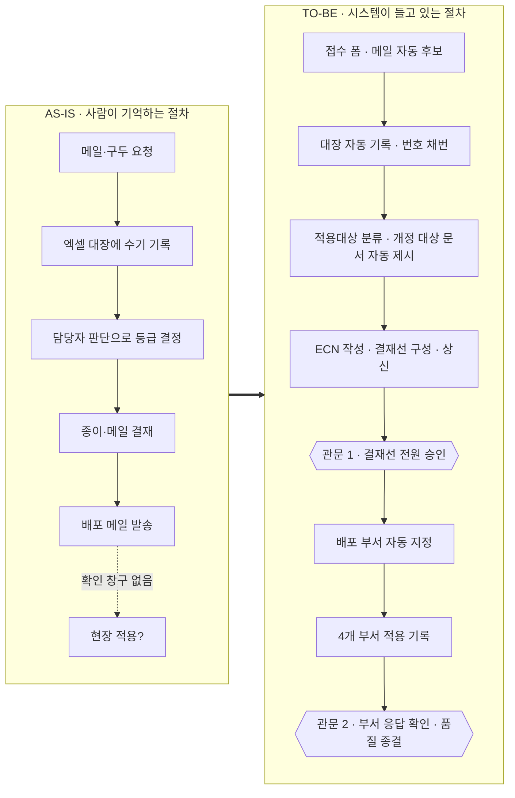
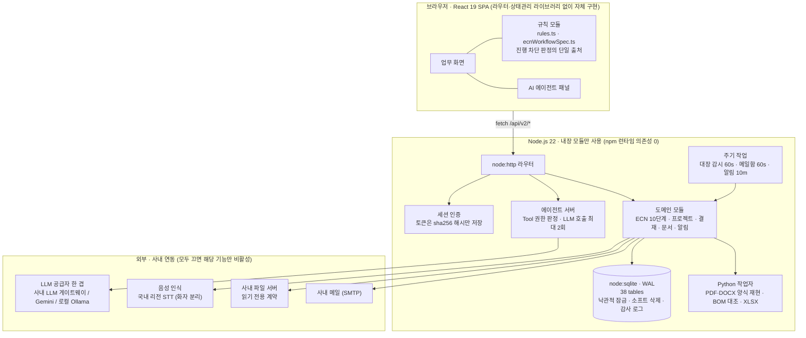
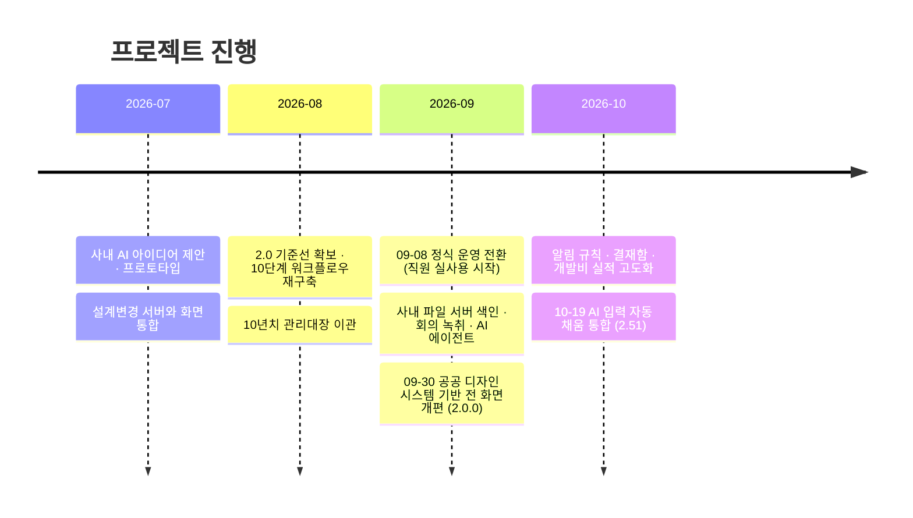

<div align="center">


# 제품 생애주기 통합관리 플랫폼

**종이와 엑셀로 돌던 설계변경 · 신규 개발 절차를, 누가 맡아도 같은 순서로 밟게 만든 사내 웹 플랫폼**

<sub>제조사 전장 연구소 · 2026.07 시작 · **2026.09.08부터 운영 중**</sub>

<br>


[English](README.md) · **한국어**

[문제](#왜-만들었나) · [프로세스 개선](#무엇을-바꿨나--프로세스-개선) · [핵심 기능](#핵심-기능) · [아키텍처](#아키텍처) · [AI 설계](#ai-설계-원칙--ai는-준비하고-사람은-판단한다) · [기술적 도전](#기술적-도전과-해결) · [개발 방식](#개발운영-방식)

</div>

---

> [!NOTE]
> 이 저장소는 **포트폴리오용 소개 저장소**입니다. 실제 소스는 회사 내부 운영 시스템이라 공개하지 않습니다.
> 화면 캡처와 예시는 모두 **가상 데이터**이고, 회사·고객사·사내 시스템 이름은 일반 명칭으로 바꿨습니다.
> 소스 코드는 면접 등 필요한 자리에서 별도로 보여 드릴 수 있습니다.

## 한눈에 보기

| | |
|---|---|
| **무엇** | 설계변경(ECN) 10단계 · 신규 개발 10단계 · 결재 · 문서 · 예산 · 알림을 한 곳에서 관리하는 사내 웹 플랫폼 |
| **누가 쓰나** | 연구소 · 품질 · 생산 · 구매 · 자재 · 영업 · 경영진 — 설계변경 한 건에 얽히는 모든 부서 |
| **상태** | 2026-09-08 정식 운영 전환. 이후 **운영 배포 210여 회**를 무중단으로 반영 |
| **규모** | 화면 TypeScript/React 약 6.5만 행 · 서버 Node.js/Python 약 3만 행 · SQLite 38개 테이블 |
| **이관** | 10년치(2016~2026) 엑셀 설계변경 관리대장을 그대로 옮겨 시스템 안에서 이어 씀 |
| **AI** | 자연어 에이전트(Tool 31종) · 회의 녹취 → 회의록 · 문서 내용 질의 · 입력값 자동 채움 |
| **특징** | 서버는 **npm 런타임 의존성 0개** — Node 내장 모듈(`node:sqlite`·`node:http`·`node:crypto`)만으로 구성 |

<!-- TODO: 가상 데이터로 찍은 대표 화면 GIF 를 docs/images/demo.gif 로 넣고 아래 주석을 푼다 -->
<!-- <p align="center"></p> -->

---

## 왜 만들었나

회사에는 이미 **설계변경 관리 지침서**와 **설계·개발 절차서**가 있었습니다. 문제는 절차서가 아니라 **절차서가 지켜지는 방식**이었습니다.

| 현장에서 실제로 일어나던 일 | 결과 |
|---|---|
| 설계변경 요청이 메일 · 구두 · 엑셀로 제각각 들어온다 | 접수 누락, 담당자마다 다른 정리 방식 |
| 변경유형 · 영향 문서 · 등급 판단이 담당자 경험에 의존 | 같은 사안에도 판단 편차, 개정 문서 누락 |
| 변경 전후 BOM을 눈으로 대조 | 부품 교체에 묻힌 수량 변경 같은 항목을 놓침 |
| 결재가 끝난 뒤 **실제 양산 라인에 적용됐는지** 확인할 창구가 없음 | 「배포」와 「현장 적용」 사이의 공백 |
| 문서가 여러 저장소에 흩어지고, 시스템이 바뀔 때마다 일부가 유실 | 필요한 자료 하나 찾는 데 한참 |
| 세분화된 규정 서식(체크시트 19항목 등) | 처음 맡은 담당자는 무엇을 써야 할지 막막 |

결국 **같은 일을 누가 맡느냐에 따라 결과가 달라지는 구조**였습니다.

## 무엇을 바꿨나 — 프로세스 개선

새 절차를 만들지 않았습니다. **이미 있는 절차서를 조항 단위로 읽어서 화면과 규칙으로 옮겼습니다.** 사람이 기억해야 했던 순서 · 기한 · 결재선 · 확인 항목을 시스템이 들고 있게 했습니다.



| 영역 | AS-IS | TO-BE |
|---|---|---|
| **접수** | 경로마다 다른 양식 | 하나의 접수 폼. 수신 메일(.eml)은 자동으로 접수 후보가 됨. 고객 요청은 **회신 기한(14일)을 자동 계산** |
| **판단** | 담당자 경험 | 적용대상(4M+S/W)을 고르면 개정 대상 양산문서가 자동 제시되고, 문서마다 Before/After · 차이점을 남김 |
| **결재** | 순차 결재, 종이·메일 | 기본 결재선을 제안하고 담당자가 조정. **순서와 무관한 동시 결재**, 승인 직전 비밀번호로 본인 확인 |
| **배포 → 적용** | 배포 메일로 끝 | 결재선에 있는 팀장의 부서가 곧 배포 대상. 구매 · 자재 · 생산 · 품질 **4개 부서가 각자 적용 사실을 기록** |
| **종결** | 대장에 Closed 표기 | **응답하지 않은 부서가 하나라도 있으면 종결 불가**. 부서 응답 → 품질팀 확인 → 종결 순서를 시스템이 강제 |
| **문서** | 개인 PC · 공유 폴더 | 산출물은 양식대로 PDF가 만들어져 문서함에 Rev 이력과 함께 쌓임 |
| **신규 개발** | 절차서 10단계를 사람이 따라감 | 단계별 대표 산출물 · 관문 4개(이사회 승인 · 연구소장 확인 · 품평회 · 고객 승인원)를 시스템이 확인 |

> 진행 차단은 **3층**으로 나눴습니다. ① 관문 미승인은 물리적으로 막고 ② 서식 미완성도 막지만 ③ 필수 산출물 미등록은 **사유를 적으면 진행**시키고 누락 알람을 계속 띄웁니다.
> 현장에는 사정이 있기 마련이라, 전부 막으면 사람들이 시스템 밖에서 일하기 시작합니다. 막을 것과 기록만 남길 것을 구분한 것이 이 설계의 핵심입니다.

### 운영하면서 절차를 더 단순하게

처음부터 완벽하게 옮기려 하지 않았습니다. 운영 전환 뒤 현업이 실제로 쓰면서 나온 의견으로 **흐름 자체를 줄여 나갔습니다.**

| 시점 | 바꾼 것 | 이유 |
|---|---|---|
| 09-08 | 「변경점 수정」과 「ECN 작성」 사이 관문 삭제 | 문서 개정과 ECN 작성은 같은 사람이 이어서 하는 일이라 관문을 둘 자리가 아니었음 |
| 09-18 | 관문 3개 → **2개**. ECN 작성 · 결재 · 배포를 「ECN 배포」 한 묶음으로 | 「쓰고 → 올리고 → 승인되면 내보낸다」는 한 흐름. 별도 등급 확정 관문은 결재에서 판단하면 됨 |
| 09-21 | 「양산 적용」 → **「적용 진행」**으로 이름 변경 | 아직 한 부서도 손대지 않은 건이 적용이 끝난 것처럼 읽히는 오해를 없앰 |
| 09-30 | 결재 **등급(Class) 폐지**, 결재선 · 회람선을 한 화면에서 직접 관리 | 등급별 결재선 네 줄보다 기본 결재선 하나 + 조정이 실제 일하는 방식에 맞음 |
| 10-05 | 배포 대상 = **결재선에 있는 팀장의 부서** | 결재한 팀은 그 부서 전원이 받으면 됨 — 같은 걸 두 번 체크하지 않게 |

단계 번호(1~10)는 저장 데이터 호환을 위해 그대로 두고 **이름 · 묶음 · 관문만 재배치**했습니다. 모든 판정이 단계 번호와 규칙 함수로만 이뤄지게 만들어 두었기 때문에, 이런 개편을 진행 중인 건을 멈추지 않고 반영할 수 있었습니다.

자세한 설계 과정은 [docs/01-process-redesign.md](docs/ko/01-process-redesign.md)에 정리했습니다.

## 핵심 기능

<table>
<tr>
<td width="50%" valign="top">

### 설계변경 10단계 워크플로우
접수 → 적용대상 분류 → 타당성 → 회의 → 변경점 수정 → ECN 작성 → 결재 → 배포 → 적용 진행 → 종결.
단계마다 요구 산출물과 진행 조건이 있고, 진행 차단 판정은 **규칙 함수 하나**(`ecnAdvanceBlocker` · `ecnClosureBlocker`)가 단일 출처로 결정합니다.

</td>
<td width="50%" valign="top">

### 신규 개발 10단계 · 관문 4개
개발 개시 → 타당성 → 계획(이사회 승인) → 설계 입력(19항목) → 설계 수행 → 시제품 → 검증 → 품평회 → 양산 이관 → 완료 보고.
검증 단계에서 **재설계 회귀**를 지원하고, 회차 · 원인 · 조치 계획을 이력으로 남깁니다.

</td>
</tr>
<tr>
<td valign="top">

### 스프레드시트형 관리대장
10년치 엑셀 대장을 27열 2단 머리글 그대로 옮겼습니다. 다중 범위 선택 · 붙여넣기 · Undo/Redo 100단계 · 셀 변경 이력 · 가상 스크롤.
원본은 건드리지 않고 **사람이 고친 값만 오버레이**로 얹어 이관 데이터와 운영 편집을 분리했습니다.

</td>
<td valign="top">

### BOM 자동 대조
변경 전후 BOM(XLSX)을 올리면 신규 · 삭제 · 수량 변경 · 위치(Ref) 변경을 찾아냅니다.
고객사마다 다른 열 이름(품번 · 수량 · Ref)은 **별칭표로 흡수**합니다.

</td>
</tr>
<tr>
<td valign="top">

### 자연어 AI 에이전트
「지난달 접수된 커넥터 건 결재 어디까지 갔어?」처럼 물으면 Tool 31종 중 필요한 것을 골라 답합니다.
조회는 서버가 권한 필터를 걸어 직접 하고, **쓰기는 사용자 확인을 받은 뒤 기존 화면 함수가 실행**합니다.

</td>
<td valign="top">

### 회의 녹음 → 회의록
회의록 폼에서 바로 녹음 → 화자 분리 녹취 → AI가 회의 내용 · 결정 사항 초안 작성 → 후속 조치를 일정에 등록.
업로드 · 녹취 · 검수를 **독립 API 3단계**로 나눠, 녹취가 실패해도 원본 음성은 남습니다.

</td>
</tr>
<tr>
<td valign="top">

### 결재함 · 기안 품의
결재 · 통보(참조) 구분, 지명 우선, 보류는 본인만 해제, 회수 조건, 열람 범위 제한.
결재 메일의 수신자는 **화면이 아니라 서버가 결재선에서 결정**합니다(임의 주소 발송 차단).

</td>
<td valign="top">

### 문서함 · 사내 파일 서버 색인
산출물은 양식 그대로의 PDF로 만들어져 Rev 이력과 함께 보관됩니다.
사내 파일 서버는 **읽기 전용 계약**으로 연동하고, 파일명 색인을 서버에 따로 두어 「Everything」처럼 즉시 검색합니다.

</td>
</tr>
</table>

<!-- TODO: 화면 캡처 (가상 데이터) — docs/images/README.md 의 목록대로 찍어 아래 표에 넣는다 -->

## 아키텍처



- **필수 런타임은 Node 하나.** AI · 녹취 · 파일 서버가 없어도 서버는 뜨고 해당 기능만 꺼집니다.
- **업무 규칙은 화면 쪽 규칙 모듈 한 곳에 둡니다.** 버튼이 열리는지, 다음 단계로 갈 수 있는지를 화면마다 따로 판단하지 않습니다.
- **프로젝트 · 기안 · ECN 본문은 `payload_json` + `version` 컬럼**으로 저장해 낙관적 잠금을 겁니다. 여러 사람이 같은 건을 동시에 열어도 덮어쓰기가 일어나지 않습니다.

더 자세한 내용: [docs/02-architecture.md](docs/ko/02-architecture.md)

## AI 설계 원칙 — 「AI는 준비하고, 사람은 판단한다」

업무 시스템에 AI를 붙일 때 가장 경계한 것은 **AI가 틀렸을 때 그 결과가 데이터로 남는 것**이었습니다.

| 원칙 | 구현 |
|---|---|
| LLM은 SQL을 만들지 않는다 | 조회는 미리 정의된 Tool의 `run()`만 실행. LLM은 어떤 Tool을 어떤 인자로 부를지만 고름 |
| LLM은 DB를 직접 고치지 않는다 | 쓰기 Tool은 서버가 실행하지 않음. 화면에 확인 창을 띄우고 **기존 접수 함수**가 실행 |
| 권한은 프롬프트로 지키지 않는다 | 세션 기준으로 서버가 Tool 실행 전에 판정. 프롬프트 우회가 권한 우회가 되지 않음 |
| 필수값을 지어내지 않는다 | 빠진 값은 되묻게 하고, 최종 관문은 화면의 등록 검증 함수가 가짐 |
| 무한 반복 금지 | 메시지 한 번에 LLM 호출 최대 2회, Tool 실행 최대 3개 |
| 사내 데이터는 밖으로 나가지 않는다 | 외부 LLM에는 실명 · 고객사 · 문서번호를 **마스킹한 뒤** 의도 판정만 맡김. 회의 음성은 마스킹이 불가능해 **국내 리전 STT**를 선택 |
| 실패를 정직하게 보여준다 | 타임아웃 · 빈 응답 · 스키마 위반 등 **11가지 폴백 조건**을 구분해 배지에 사유를 표시 |
| AI가 채운 값은 표시한다 | 추천 카드나 「적용」 단추 대신 값을 기존 칸에 바로 채우고, 그 구역에 **「AI 생성」 표식**을 붙임. 사람은 확인하고 고치기만 하면 됨 |

LLM 공급자는 운영 중에 외부 API에서 사내 게이트웨이로 바뀌었습니다. 이때 화면 계약(설정 필드 이름)을 그대로 유지해 **화면은 건드리지 않고 공급자만 교체**했고, 같은 일이 또 생길 것이므로 에이전트는 처음부터 「공급자 한 겹」을 두고 시작했습니다. 사내 게이트웨이에 네이티브 tool calling이 없어서, Tool 호출은 **「JSON만 출력」 규약**으로 구현해 어느 공급자에서도 똑같이 동작하게 했습니다.

더 자세한 내용: [docs/03-ai-design.md](docs/ko/03-ai-design.md)

## 기술적 도전과 해결

<details open>
<summary><b>1. 외부 이벤트 API가 페이지 파라미터를 조용히 무시하던 문제</b></summary>

사내 파일 서버 색인을 변경 이벤트로 갱신하는데, 「이벤트 6,000건 처리」라는 로그와 달리 일부 파일이 검색에 안 나왔습니다.
API를 직접 실측해 보니 **`skip` · `page` 파라미터가 무시돼 매번 같은 최신 100건이 왔고**, 코드는 그 100건을 60번 세면서 시각을 끝까지 전진시키고 있었습니다. 그 사이 이벤트는 영영 누락되는 구조였습니다.
→ `to_timestamp`가 정상 동작하고 창의 총건수(`totalNodes`)를 준다는 점을 이용해, **시간 창을 반으로 쪼개 가며(이분) 100건 이하가 될 때까지 좁혀 훑는 방식**으로 다시 짰습니다. 창 하나를 통째로 다 읽었을 때만 워터마크를 전진시켜, 못 읽은 구간을 건너뛰는 일이 없게 했습니다. 문서가 아니라 실측을 기준으로 설계한다는 원칙이 생긴 계기입니다.
</details>

<details>
<summary><b>2. 직원이 쓰는 중에 하루 수 회씩 배포하기</b></summary>

운영 전환 뒤에도 현업 요청이 매일 들어왔습니다. 서버 원격 기동이 불가능한 망 구조(파일 공유와 HTTP만 열림)라서 배포 절차를 이렇게 정했습니다.
- 빌드 결과물은 해시가 붙은 번들이라 **구 번들을 지우지 않고 그대로 둡니다.** `index.html` 하나만 되돌리면 즉시 롤백됩니다.
- 배포 전 화면 폴더를 `_publicbackup_<시각>_<사유>`로 백업하고, 다른 작업자의 배포분을 덮지 않도록 **빌드 사본을 전수 비교**합니다.
- 서버는 파일 저장만으로 재기동되게(`node --watch`) 해서 콘솔 접속 없이도 반영되게 했습니다.

이 방식으로 운영 전환 뒤 210여 회를 배포했습니다.
</details>

<details>
<summary><b>3. 10년치 엑셀 대장을 「원본 보존 + 운영 편집」으로 이관</b></summary>

관리대장은 엑셀에서 계속 갱신되던 살아 있는 문서였습니다. 한 번에 옮기고 끝내면 엑셀 쪽 수정이 사라지고, 계속 동기화하면 시스템에서 고친 값이 덮입니다.
→ 엑셀 원본을 60초마다 서명(해시)으로 감시해 원본 행을 갱신하고, 사람이 시스템에서 고친 값은 **셀 단위 오버레이 테이블**에 따로 저장해 위에 얹었습니다. 원본과 편집이 섞이지 않으니 셀마다 「누가 언제 무엇을 고쳤는지」도 그대로 남습니다.
</details>

<details>
<summary><b>4. 절차서 개편이 화면 문구가 아니라 업무 흐름을 바꾸는 경우</b></summary>

운영 중 「변경점 수정」과 「ECN 작성」 단계의 책임을 다시 나누는 개편이 있었습니다. 문구만 바꾸면 이미 진행 중인 건들의 진행 조건과 PDF 자동 보관 시점이 어긋납니다.
→ 진행 차단 판정을 **규칙 함수 하나**로 모아 두었기 때문에 판정 · 자동 처리 시점 · 반려 시 회귀 지점을 한 곳에서 바꾸고, 진행 중인 건이 어느 단계에 있든 같은 규칙으로 다시 판정되게 했습니다. 반려 시에는 등급 확정도 함께 해제됩니다(등급 자체가 반려 사유일 수 있으므로).
</details>

<details>
<summary><b>5. 외부 LLM 한도 초과 · 장애에서도 멈추지 않는 코파일럿</b></summary>

무료 한도 초과(429)가 나면 코파일럿이 통째로 먹통이 됐습니다.
→ 일일 예산 · 429 수신 시 **10분 회로 차단기** · 실패 사유별 계측 · 무응답률 측정을 넣고, 실패하면 로컬 규칙 분류기로 폴백합니다. 측정해 보니 폴백 품질이 낮은 진짜 원인은 모델이 아니라 **로컬 분류기가 정규식 몇 줄**이라는 점이었고, 규칙 점수제 · 슬롯 추출로 무료 · 오프라인 개선부터 했습니다.
</details>

<details>
<summary><b>6. 외부 시스템은 「읽기 전용 계약」으로만</b></summary>

사내 파일 서버는 전사 자료가 있는 곳이라, 버그 하나로 파일이 지워지거나 옮겨지면 복구가 어렵습니다.
→ 외부 호출을 **`guardedFetch`** 한 곳으로 모으고, 모든 열람 · 검색 경로에서 **허용 루트 밖은 403**으로 막았습니다. 특정 보안 폴더는 색인 · 열람 · 검색 · 다운로드 전 경로에서 차단했습니다. 쓰기가 필요한 백업 업로드는 별도 모듈로 분리해 권한 범위를 나눴습니다.
</details>

더 많은 사례와 의사결정 기록(ADR): [docs/04-engineering-decisions.md](docs/ko/04-engineering-decisions.md)

## 개발·운영 방식

- **AI 페어 프로그래밍** — 설계 · 구현 · 리뷰 전 과정에 Claude Code를 썼습니다. 저는 요구사항 정의, 절차서 해석, 설계 결정, 검증, 운영 판단을 맡고, 구현은 AI와 함께 진행했습니다. 여러 AI 세션이 같은 트리에서 동시에 일하는 환경이라 **인수인계 문서(HANDOFF)**, 작업 전 `git status` 확인, 배포 전 빌드 사본 비교를 규칙으로 만들었습니다.
- **변경 이력 원장** — 소스를 고치면 작업을 끝내기 전에 반드시 원장에 남깁니다. 파일 경로가 아니라 **사용자가 보는 메뉴 경로**로 「기존 문제 → 바뀐 동작 → 운영 시 주의」를 적어, 현업 담당자가 읽어도 판단이 서게 했습니다(변경 이력 1,300건 이상 기록).
- **버전 규칙** — 운영 배포 한 번 = 버전 하나. 운영 체계 변경은 첫째 자리, 기능 · 규칙 변경은 둘째, 수정 · 손질은 셋째. 과거 백업 폴더를 근거로 0.0.1부터 소급해 매겼습니다.
- **공공 디자인 시스템 적용** — 2.0.0에서 전 화면을 대한민국 정부 디자인 시스템(KRDS) 기반으로 다시 설계했습니다. 화면별로 px를 덮어쓰지 않고 **공용 UI 정본 컴포넌트**에서 단계로만 조정합니다.
- **운영 중 보안 점검** — 정기적으로 직접 점검하고 우선순위를 매겨 조치합니다. 예: 로그인 전에 계정 목록이 내려가던 문제 수정, 외부 반출 백업의 AES-256-GCM 암호화.

자세한 내용: [docs/05-operations.md](docs/ko/05-operations.md)

## 타임라인



## 기술 스택

| 영역 | 사용 기술 | 선택 이유 |
|---|---|---|
| 화면 | React 19 · TypeScript 6 · Vite 8 · oxlint | 라우터 · 상태관리 라이브러리 없이 자체 구현 — 업무 규칙이 단순한 상태 전이라 의존성보다 직접 제어가 낫다고 판단 |
| 서버 | Node.js 22 내장 모듈만 (`node:http` · `node:sqlite` · `node:crypto` · `node:child_process`) | 사내 서버에 패키지 설치 · 업데이트 경로가 없음. 의존성 0개로 공급망 위험과 설치 부담을 없앰 |
| DB | SQLite (WAL) | 단일 서버 · 수십 명 규모. 파일 하나로 백업 · 이관 · 롤백 |
| 문서 | Python (reportlab · PyMuPDF · openpyxl · python-docx) | 사내 양식(PDF · DOCX · XLSX)을 빈 칸 · 안내 문구까지 그대로 재현 |
| AI | 사내 LLM 게이트웨이 · Gemini · Ollama(로컬) · 국내 리전 STT | 공급자 추상화로 교체 가능하게. 데이터 반출 여부가 공급자 선택 기준 |
| 디자인 | KRDS(정부 디자인 시스템) 기반 자체 UI 정본 | 접근성 · 가독성 기준이 검증된 체계 |

## 내 역할


- 현업 절차서(설계변경 지침서 · 설계·개발 절차서)를 조항 단위로 분석해 **화면 · 규칙 · 관문으로 옮기는 설계**
- 화면 · 서버 · 문서 생성 · AI 기능 **기획과 개발**
- 운영 전환(데이터 이관 · 포트 인계 · 롤백 절차) 계획과 실행
- 현업 요청 접수 → 우선순위 → 배포 → 변경 이력 기록까지 **운영 전 과정**

## 배운 점

- **절차를 전산화한다는 건 「막을 것」과 「기록만 남길 것」을 나누는 일이다.** 전부 막으면 사람들은 시스템 밖에서 일한다.
- **외부 API는 문서보다 실측을 믿는다.** 페이지 파라미터 하나 때문에 데이터가 조용히 사라질 수 있다.
- **AI 기능의 품질은 모델보다 실패 처리에서 갈린다.** 폴백 · 계측 · 정직한 실패 표시가 있어야 운영할 수 있다.
- **운영 중인 시스템에서는 롤백이 기능이다.** 되돌릴 방법이 먼저 있어야 빠르게 고칠 수 있다.

## 이 저장소의 구성

```
.
├── README.md                     ← English
├── README.ko.md                  ← 한국어
└── docs/
    ├── ko/                       ← 세부 문서 한국어판
    ├── 01-process-redesign.md    ← 절차서 → 화면 · 규칙 · 관문으로 옮긴 과정
    ├── 02-architecture.md        ← 구성 · 데이터 모델 · API · 주기 작업
    ├── 03-ai-design.md           ← 에이전트 · 코파일럿 · 녹취 · 안전 설계
    ├── 04-engineering-decisions.md ← 의사결정 기록 (ADR)
    ├── 05-operations.md          ← 배포 · 롤백 · 버전 · 변경 이력 · 보안 점검
    └── images/                   ← 배너 · 화면 캡처 (가상 데이터)
```

## 연락

<!-- TODO: 이메일 · 블로그 · LinkedIn 등 -->
- GitHub: [@hupositoc](https://github.com/hupositoc)

<sub>이 문서의 회사 · 고객사 · 사내 시스템 이름은 일반 명칭으로 바꿨고, 화면 예시는 모두 가상 데이터입니다. © 2026 · All rights reserved.</sub>
