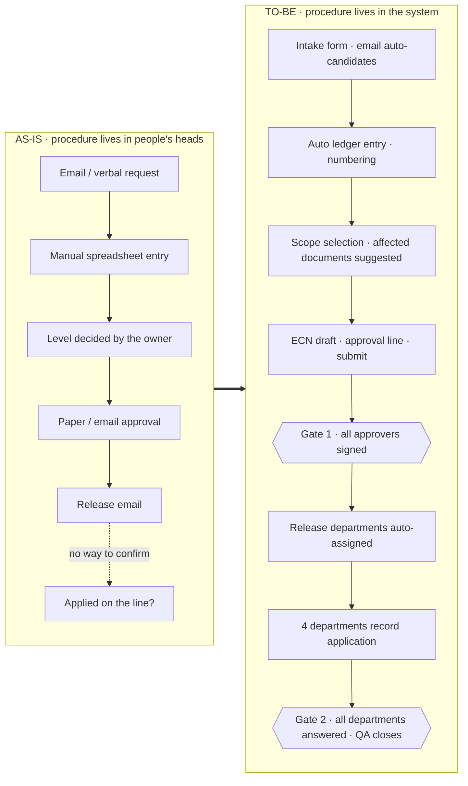
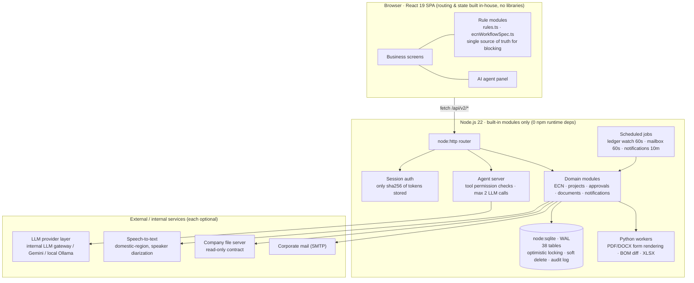
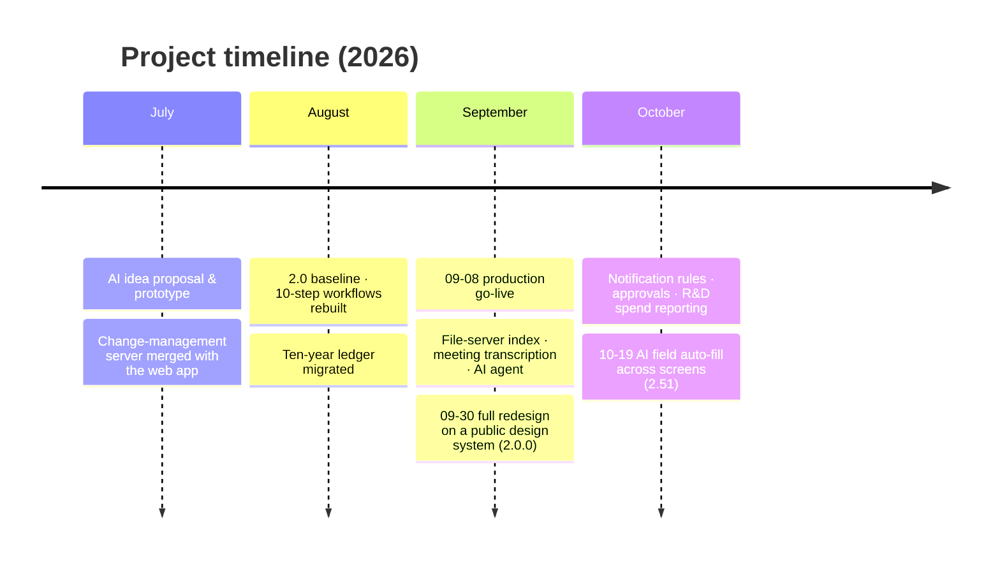

<div align="center">


# Product Lifecycle Workflow Platform

**An in-house web platform that turns paper-and-spreadsheet engineering change and product development procedures into workflows that run the same way no matter who handles them.**

<sub>Electronics R&D center of a manufacturer · started 2026-07 · **in production since 2026-09-08**</sub>

<br>


**English** · [한국어](README.ko.md)

[Problem](#the-problem) · [Process redesign](#what-changed--process-redesign) · [Features](#key-features) · [Architecture](#architecture) · [AI design](#ai-design--ai-prepares-people-decide) · [Challenges](#engineering-challenges) · [How I worked](#how-i-built-and-ran-it)

</div>

---

> [!NOTE]
> This is a **portfolio showcase repository**. The source code belongs to an internal production system and is not published.
> All screenshots and examples use **synthetic data**, and company, customer and internal-system names have been generalized.
> I'm happy to walk through the code in an interview.

## At a glance

| | |
|---|---|
| **What** | One web platform for engineering changes (ECN, 10 steps), new product development (10 steps), approvals, documents, budgets and notifications |
| **Users** | R&D, Quality, Production, Purchasing, Materials, Sales and management, i.e. every department one engineering change touches |
| **Status** | Went live on 2026-09-08 and has shipped **210+ production releases** since, without downtime for users |
| **Size** | ~65k lines of TypeScript/React frontend · ~30k lines of Node.js/Python backend · 38 SQLite tables |
| **Migration** | A decade (2016–2026) of spreadsheet change ledgers migrated and still edited in place |
| **AI** | Natural-language agent (31 tools) · meeting recording → minutes · Q&A over document contents · AI-filled form fields |
| **Notable** | The server has **zero npm runtime dependencies**. It is built only on Node built-ins (`node:sqlite`, `node:http`, `node:crypto`) |

<!-- TODO: add a short demo recorded on synthetic data as docs/images/demo.gif and uncomment -->
<!-- <p align="center"></p> -->

---

## The problem

The company already had an **engineering change management standard** and a **design & development procedure**. The problem wasn't the procedures. It was **how they were followed**.

| What actually happened | Consequence |
|---|---|
| Change requests arrived by email, in person or as spreadsheets | Requests got lost; every owner tracked them differently |
| Change type, affected documents and approval level depended on individual experience | The same case was judged differently; document revisions were missed |
| Before/after BOMs were compared by eye | Easy to miss a quantity change buried inside a part substitution |
| After approval, nobody could see **whether the change actually reached the production line** | A gap between "released" and "applied on the floor" |
| Documents were spread across several stores, and some were lost at every system migration | Finding a single file took far too long |
| Detailed forms (e.g. a 19-item design input checklist) | New owners didn't know where to start |

In short, **the outcome depended on who happened to handle the work.**

## What changed — process redesign

I didn't invent a new process. I **read the existing procedures clause by clause and turned them into screens, rules and gates**, so the system, not people's memory, holds the order, deadlines, approval lines and checks.



| Area | AS-IS | TO-BE |
|---|---|---|
| **Intake** | A different format per channel | One intake form. Incoming emails (.eml) become intake candidates automatically. Customer requests get their **14-day reply deadline computed** |
| **Assessment** | Individual experience | Picking the scope (4M + S/W) suggests the production documents to revise; each records before/after and the diff |
| **Approval** | Sequential, on paper or email | A default approval line the owner can adjust; **parallel approval in any order**; password re-check right before signing |
| **Release → application** | Ended with a release email | Departments of the approvers become the release list; Purchasing, Materials, Production and Quality **each record their own application** |
| **Closure** | "Closed" typed into the ledger | **Cannot close while any department hasn't answered.** The system enforces department answers → QA check → closure |
| **Documents** | Personal PCs, shared folders | Deliverables are generated as PDFs from the official forms and stored with revision history |
| **New development** | People walk through the 10-step procedure | Deliverables per step and four gates (board approval, R&D head sign-off, design review, customer approval) checked by the system |

> Blocking is split into **three tiers**. ① Unapproved gates are hard-blocked. ② Incomplete forms are blocked. ③ Missing deliverables can proceed **once a reason is recorded**, and the alarm stays on.
> Real work always has exceptions. Block everything and people start working outside the system. Deciding *what to block* versus *what to just record* is the core of this design.

### Simplifying the process while in production

I didn't try to get everything right up front. After go-live, **user feedback shrank the flow itself.**

| Date | Change | Why |
|---|---|---|
| 09-08 | Removed the gate between "revise documents" and "draft ECN" | The same person does both, back to back. There was nothing to gate |
| 09-18 | 3 gates → **2**; drafting, approval and release grouped as one "ECN release" phase | "Write → submit → release on approval" is one flow; level sign-off belongs in the approval itself |
| 09-21 | Renamed "Production applied" → **"Applying"** | Cases no department had touched yet read as if they were done |
| 09-30 | **Removed approval classes**; approval and circulation lines managed directly on one screen | One default line plus adjustments matched how people actually work better than four class-specific lines |
| 10-05 | Release list = **departments of the team leads on the approval line** | A team that signed off receives it as a whole, so nobody checks the same thing twice |

Step numbers (1–10) stayed fixed for data compatibility; only **names, grouping and gates moved**. Because every decision is made from the step number and a rule function, each redesign shipped without pausing cases already in progress.

More detail: [docs/01-process-redesign.md](docs/01-process-redesign.md)

## Key features

<table>
<tr>
<td width="50%" valign="top">

### 10-step engineering change workflow
Intake → scope → feasibility → meeting → revise documents → draft ECN → approval → release → applying → closure.
Every step has required deliverables and conditions, and **a single rule function** (`ecnAdvanceBlocker` / `ecnClosureBlocker`) is the one source of truth for "can this move forward?".

</td>
<td width="50%" valign="top">

### 10-step product development · 4 gates
Kick-off → feasibility → plan (board approval) → design input (19 items) → design → prototype → verification → design review → transfer to production → completion report.
Supports **redesign loops** from verification, recording the round, root cause and action plan.

</td>
</tr>
<tr>
<td valign="top">

### Spreadsheet-style ledger
The decade-old spreadsheet ledger, rebuilt with its 27 columns and two-row headers. Multi-range selection, paste, 100-step undo/redo, per-cell history, virtual scrolling.
The source rows are never touched; **human edits live in an overlay**, keeping migrated data and live edits apart.

</td>
<td valign="top">

### Automatic BOM diff
Upload before/after BOMs (XLSX) to find added, removed, quantity-changed and reference-changed parts.
Each customer names columns differently (part no., qty, ref); an **alias table absorbs** the differences.

</td>
</tr>
<tr>
<td valign="top">

### Natural-language AI agent
Ask "How far along is approval on last month's connector change?" and it picks from 31 tools to answer.
Reads run on the server behind permission filters; **writes run through existing UI functions only after the user confirms**.

</td>
<td valign="top">

### Meeting recording → minutes
Record from the minutes form → speaker-separated transcript → AI drafts the discussion and decisions → follow-ups go onto calendars.
Upload, transcription and review are **three independent APIs**, so the audio survives a failed transcription.

</td>
</tr>
<tr>
<td valign="top">

### Approvals · expense requests
Approve vs. notify-only steps, named approvers first, holds only the holder can release, withdrawal rules, restricted visibility.
Approval email recipients are **chosen by the server from the approval line, never by the client**, which blocks sending to arbitrary addresses.

</td>
<td valign="top">

### Documents · file-server index
Deliverables are generated as PDFs that match the official forms and kept with revision history.
The company file server is integrated under a **read-only contract**, with a server-side filename index for "Everything"-style instant search.

</td>
</tr>
</table>

<!-- TODO: screenshots on synthetic data — see docs/images/README.md -->

## Architecture



- **Node is the only hard requirement.** Without AI, transcription or the file server, the server still starts and only those features turn off.
- **Business rules live in one place on the client.** No screen decides on its own whether a button is enabled or a step can advance.
- **Projects, expense requests and ECN bodies are stored as `payload_json` + `version`** with optimistic locking, so people editing the same case at once never overwrite each other.

More detail: [docs/02-architecture.md](docs/02-architecture.md)

## AI design — "AI prepares, people decide"

What I guarded against most when adding AI to a business system was **an AI mistake persisting as data**.

| Principle | Implementation |
|---|---|
| The LLM never writes SQL | Reads only call predefined tools' `run()`; the LLM just picks the tool and arguments |
| The LLM never writes to the DB | Write tools aren't executed by the server. The UI shows a confirmation and the **existing intake function** runs it |
| Permissions aren't enforced by prompts | The server checks the session before any tool runs, so a prompt bypass is never a permission bypass |
| No invented required fields | Missing values are asked for; the UI's submit validator is the final gate |
| No runaway loops | Per user message: at most 2 LLM calls and 3 tool runs |
| Company data stays inside | External LLMs only see **masked** text (names, customers, document numbers) for intent detection. Meeting audio can't be masked, so a **domestic-region STT** was chosen |
| Fail honestly | **11 distinct fallback conditions** (timeout, empty reply, schema violation, …) with the reason shown on a badge |
| Mark what AI filled | No suggestion cards or "Apply" buttons. Values go straight into the fields, with an **"AI-generated"** tag on that section |

The LLM provider changed during production, from an external API to an internal gateway. Keeping the UI contract (config field names) stable meant **only the provider was swapped and the UI didn't change**. Expecting that to happen again, I gave the agent a provider abstraction layer from day one. The internal gateway has no native tool calling, so tool calls use a **"JSON-only output" protocol** that works the same on any provider.

More detail: [docs/03-ai-design.md](docs/03-ai-design.md)

## Engineering challenges

<details open>
<summary><b>1. An external events API silently ignored its paging parameters</b></summary>

The file-server index is kept current from change events. Logs said "6,000 events processed", yet some files never showed up in search.
Measuring the API directly showed that **`skip` and `page` were ignored**: every call returned the same latest 100 events. The code counted those 100 sixty times while advancing its watermark to the end, so everything in between was lost for good.
→ `to_timestamp` did work, and responses reported the window's total (`totalNodes`). I rewrote paging to **bisect the time window until each slice held ≤ 100 events**, and to advance the watermark only after a window was read completely, so no gap is ever skipped. Since then, I measure an external API's real behavior first and design to that, not to its docs.
</details>

<details>
<summary><b>2. Shipping several times a day while people are using it</b></summary>

Requests kept arriving daily after go-live. The network only exposes file sharing and HTTP, so the server can't be restarted remotely. The release procedure became:
- Build output is content-hashed, so **old bundles are never deleted**. Rolling back means restoring a single `index.html`.
- Before every release the served folder is backed up as `_publicbackup_<time>_<reason>`, and build copies are **diffed file by file** so another contributor's release is never overwritten.
- The server runs under `node --watch`, so saving a file restarts it without console access.

That's how 210+ releases shipped after go-live.
</details>

<details>
<summary><b>3. Migrating ten years of spreadsheets as "source + live edits"</b></summary>

The ledger was a living spreadsheet that people kept updating. A one-off import would lose spreadsheet edits; continuous sync would overwrite edits made in the system.
→ The source workbook is watched by signature (hash) every 60 seconds to refresh source rows, while edits made in the system are stored in a **per-cell overlay table** layered on top. Source and edits never mix, and every cell keeps its own "who changed what, when" history.
</details>

<details>
<summary><b>4. When a procedure change rewires the workflow, not just labels</b></summary>

One redesign during production moved responsibilities between "revise documents" and "draft ECN". Changing labels alone would have broken advance conditions and the timing of automatic PDF archiving for cases already in flight.
→ Because blocking decisions live in **a single rule function**, the decision logic, automation timing and rejection fallback point all changed in one place, and in-flight cases were re-evaluated under the same rules wherever they were.
</details>

<details>
<summary><b>5. A copilot that keeps working through rate limits and outages</b></summary>

Hitting the free quota (HTTP 429) used to take the copilot down entirely.
→ Added a daily budget, a **10-minute circuit breaker** on 429, per-reason failure metrics and a no-answer rate, with fallback to a local rule-based classifier. The metrics showed the real cause of poor fallback quality wasn't the model. **The local classifier was a few lines of regex.** Rewriting it as per-intent scoring with slot extraction gave a free, offline improvement first.
</details>

<details>
<summary><b>6. External systems only under a read-only contract</b></summary>

The company file server holds data for the whole organization. One bug that deletes or moves files would be hard to undo.
→ All outbound calls go through **one `guardedFetch`**, and every browse and search path returns **403 outside the allowed roots**. A restricted folder is blocked across indexing, browsing, search and download. The one write path (encrypted backup upload) lives in a separate module with its own scope.
</details>

More cases and Architecture Decision Records: [docs/04-engineering-decisions.md](docs/04-engineering-decisions.md)

## How I built and ran it

- **AI pair programming.** I used Claude Code throughout design, implementation and review. I owned requirements, interpreting the procedures, design decisions, verification and operational calls, and built the implementation together with the AI. Several AI sessions often worked in the same tree at once, so I made **handoff documents**, a `git status` check before every commit and build-copy diffs before every release into standing rules.
- **Change ledger.** Every source change is logged before the task is closed. Entries name the **menu path users see**, not file paths, as "previous problem → new behavior → operational notes", so a business user can read it and act. There are 1,300+ entries so far.
- **Versioning.** One production release = one version. Operating-model changes bump major, features and rule changes bump minor, fixes and polish bump patch. I back-filled every version from 0.0.1 using past release backups.
- **Public design system.** Version 2.0.0 redesigned every screen on the Korean government design system (KRDS). Screens never override sizes ad hoc; they only use the steps defined in **shared canonical UI components**.
- **Security reviews in production.** I review the system regularly and fix findings by priority, for example the account list being sent before login, or encrypting offsite backups with AES-256-GCM.

More detail: [docs/05-operations.md](docs/05-operations.md)

## Timeline



## Tech stack

| Area | Technology | Why |
|---|---|---|
| Frontend | React 19 · TypeScript 6 · Vite 8 · oxlint | No router or state library. The workflows are simple state transitions, and direct control read better than another dependency |
| Server | Node.js 22 built-ins only (`node:http`, `node:sqlite`, `node:crypto`, `node:child_process`) | No practical way to install or update packages on the company server. Zero dependencies also means zero supply-chain risk |
| Database | SQLite (WAL) | One server, tens of users. One file to back up, migrate and roll back |
| Documents | Python (reportlab, PyMuPDF, openpyxl, python-docx) | Reproduces the official PDF/DOCX/XLSX forms down to blank cells and hint text |
| AI | Internal LLM gateway · Gemini · Ollama (local) · domestic-region STT | Swappable behind a provider layer; where the data goes decides the provider |
| Design | In-house canonical UI on KRDS (Korean government design system) | Proven accessibility and readability standards |

## My role

- Analyzed the company procedures (engineering change standard, design & development procedure) clause by clause and **designed how they map to screens, rules and gates**
- **Planned and built** the frontend, server, document generation and AI features
- Planned and executed the production cutover (data migration, port handover, rollback plan)
- Ran **the full operating loop**: intake of user requests → prioritization → release → change-ledger entry

## What I learned

- **Digitizing a procedure means deciding what to block and what to only record.** Block everything and people work around the system.
- **Trust measurements over API docs.** One paging parameter can make data disappear silently.
- **AI feature quality is decided by failure handling more than by the model.** You can't operate it without fallbacks, metrics and honest failure states.
- **In a live system, rollback is a feature.** You can only fix fast if you can undo fast.

## Repository layout

```
.
├── README.md                       ← you are here (English)
├── README.ko.md                    ← Korean
└── docs/
    ├── 01-process-redesign.md      ← procedures → screens, rules, gates
    ├── 02-architecture.md          ← components, data model, API, jobs
    ├── 03-ai-design.md             ← agent, copilot, transcription, safety
    ├── 04-engineering-decisions.md ← Architecture Decision Records
    ├── 05-operations.md            ← releases, rollback, versioning, change log, security
    ├── ko/                         ← Korean versions of the docs
    └── images/                     ← banner, screenshots (synthetic data)
```

## Contact

<!-- TODO: email · blog · LinkedIn -->
- GitHub: [@hupositoc](https://github.com/hupositoc)

<sub>Company, customer and internal-system names in this repository have been generalized, and all examples use synthetic data. © 2026 · All rights reserved.</sub>
