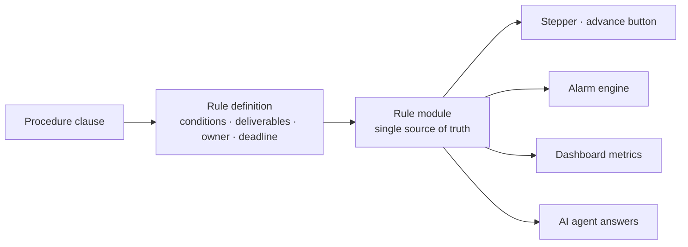
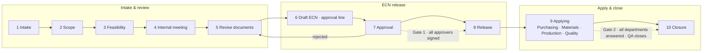

# 01. Turning procedures into screens, rules and gates

[← README](../README.md) · [한국어](ko/01-process-redesign.md)

## Starting point: the procedures already existed

The company had two internal standards under its quality management system.

| Standard | Covers | Steps |
|---|---|---|
| Engineering change management standard | Post-production design changes (ECN), from intake to shop-floor application and closure | 10 |
| Design & development procedure | New products, from kick-off to transfer to production and the completion report | 10 |

The documents were well written, but in practice they ran on **people's memory and spreadsheets**. So the goal was not "design a new process" but **"make the same procedure run in the same order, whoever handles it."**

## Method: clause → rule → screen

1. **Read each clause and turn it into a table.** For every step: who does what, in which form, by when. The official form templates were the reference.
2. **Keep rules in one place.** "Can this case move to the next step?" is never decided per screen. One rule function, such as `ecnAdvanceBlocker()` or `ecnClosureBlocker()`, answers it, and screens, alarms, dashboards and the AI agent all call the same function.
3. **Record the source.** So the system never invents rules the procedure doesn't contain, each rule carries a comment citing its clause or the business decision (date and content) behind it. That went as far as confirming that the words "gate" and "checkpoint" never appear anywhere in the standard's text.

## Engineering change (ECN) flow — current

| Step | What the system takes care of |
|---|---|
| 1 Intake | Required fields per channel, automatic numbering, automatic ledger entry, **reply deadline** for customer requests. Incoming email becomes an intake candidate; **duplicate intakes and frequently changed parts are flagged** |
| 2 Scope | Pick 4M (man, machine, material, method) + S/W → **production documents to revise are suggested** |
| 4 Internal meeting | Minutes form + meeting recording → transcript → AI draft. Minor cases can skip with a recorded reason |
| 5 Revise documents | Before/after and diff for each production document, revised file upload. Automatic BOM diff when a BOM is involved |
| 6–8 ECN release | ECN form generated as PDF and archived, approval line built and submitted, release departments assigned on approval |
| 9 Applying | Each of the four departments records what it applied and when. Items that can't be applied immediately go to the monthly review |
| 10 Closure | **Cannot close while any department hasn't answered.** Department answers → QA check → closure |

### Rejection and rework
A rejected approval returns the case to step 5 (revise documents). Documents and history are kept, and the case goes through the approval line again. When resubmitting, a **resubmission helper** summarizes the rejection comments and what has changed since.

## New product development flow

| Phase | Steps | Gate |
|---|---|---|
| Planning | 1 Kick-off · 2 Feasibility review · 3 Development plan | **Board approval** |
| Design | 4 Design input (19-item checklist) · 5 Design | **R&D head sign-off** |
| Verification | 6 Prototype · 7 Design verification · 8 Design review | **Design review passed** |
| Transfer | 9 Transfer to production (14-item checklist) · 10 Completion report | **Customer approval** |

- **Three tiers of blocking**: unapproved gate (blocked) / incomplete form (blocked) / missing deliverable (**proceeds with a recorded reason**, alarm stays on)
- **Redesign loop**: only from design verification can a project go back to design or prototype. A round name and root cause are required, plus an action plan from round 2. Deliverables and gate approvals are kept.
- **Two ways to register a deliverable**: fill the form (popup form → PDF → document store; if PDF generation fails, nothing is registered) / attach a file (filename vs. deliverable name is checked **before** upload; a mismatch stops it)

## Block, record or notify

| Kind | Examples | Handling |
|---|---|---|
| Block | Approval missing, a department hasn't answered, required form incomplete | Button stays disabled, with the reason shown next to it |
| Record and proceed | Required deliverable missing, minor case skipping the meeting | Enter a reason → proceed → alarm remains |
| Notify only | Schedule overrun, budget overrun, reply deadline near, pending approval | Computed by the alarm engine from current state (a derived value, never stored) |

Alarms are **recomputed from state every time instead of stored**. Once stored alarms drift from reality, nobody trusts them again.

## A record of simplifying while live

| Date | Change | Reason |
|---|---|---|
| 09-08 | Dropped the change-type picker in step 2 and renamed it "Scope" | All the step really did was confirm the scope |
| 09-08 | Removed the gate between steps 5 and 6; ECN drafting moved to step 6 | Deciding the level while writing the ECN is the real order of work |
| 09-18 | 3 gates → 2; steps 6–8 grouped as "ECN release" | Write → submit → release on approval is one flow |
| 09-21 | "Production applied" → "Applying" | It is the whole span in which four departments **carry out** the change |
| 09-23 | QA approval alone no longer closes a case | Pilot feedback: department review → QA check → confirm each department's result → close |
| 09-30 | Approval classes removed; approval and circulation lines edited directly | An alarm that blocked nothing ("level confirmation pending") was removed too |
| 10-05 | Release list = departments of the team leads on the approval line | Nobody checks the same thing twice |

Step **numbers were never changed**; only names, grouping and gates were rearranged. Before changing them I verified that every decision in the app uses step numbers and rule functions, and that nothing compares step names as values.
