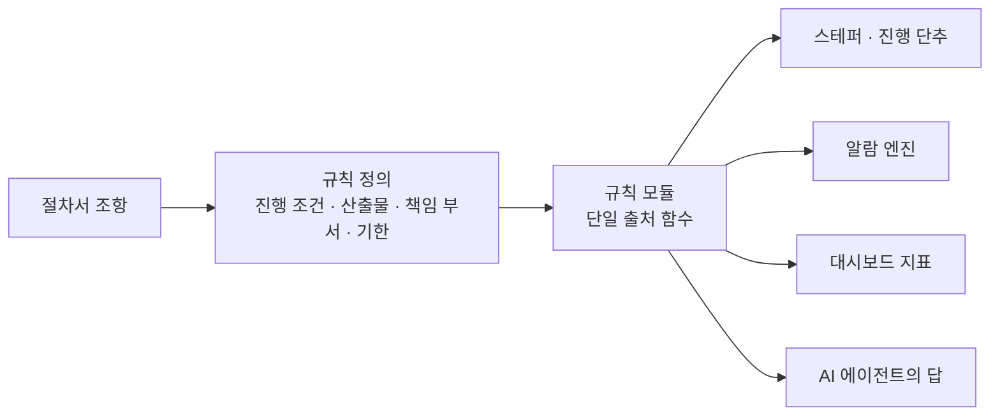
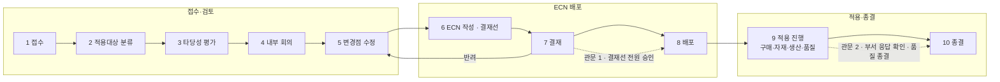

# 01. 절차서를 화면 · 규칙 · 관문으로 옮긴 과정

[← README](../README.md)

## 출발점: 절차는 있었다

회사에는 품질경영 체계에 따른 두 개의 사내 표준이 있었습니다.

| 표준 | 다루는 일 | 단계 |
|---|---|---|
| 설계변경 관리 지침서 | 양산 이후의 설계 변경(ECN) — 접수부터 현장 적용 · 종결까지 | 10단계 |
| 설계·개발 절차서 | 신규 제품 개발 — 개발 개시부터 양산 이관 · 완료 보고까지 | 10단계 |

절차서는 잘 쓰여 있었지만, 실제로 지켜지는 방식은 **담당자의 기억과 엑셀**이었습니다. 그래서 목표를 「새 프로세스 설계」가 아니라 **「같은 절차를 누가 맡아도 같은 순서로 밟게 하는 것」**으로 잡았습니다.

## 방법: 조항 → 규칙 → 화면

1. **조항을 읽고 표로 만든다** — 단계마다 「누가 · 무엇을 · 어떤 서식으로 · 언제까지」를 뽑았습니다. 서식은 사내 양식 원본을 그대로 기준으로 삼았습니다.
2. **규칙을 한 곳에 둔다** — 「이 건이 다음 단계로 갈 수 있는가」는 화면마다 판단하지 않고 `ecnAdvanceBlocker()` · `ecnClosureBlocker()` 같은 규칙 함수 하나가 결정합니다. 화면 · 알람 · 대시보드 · AI 답변이 같은 함수를 봅니다.
3. **근거를 남긴다** — 절차서에 없는 것을 시스템이 지어내지 않도록, 규칙마다 근거 조항이나 현업 결정(날짜 · 결정 내용)을 주석으로 남겼습니다. 예를 들어 「GATE · 게이트 · 관문」이라는 말은 지침서 전문에 한 번도 나오지 않는다는 것까지 확인해 기록했습니다.

## 설계변경(ECN) 흐름 — 현재

| 단계 | 시스템이 대신 챙기는 것 |
|---|---|
| 1 접수 | 접수 경로별 필수값 검증, 번호 자동 채번, 관리대장 자동 기록, 고객 요청은 **회신 기한 자동 계산**. 수신 메일은 자동으로 접수 후보가 되고, 같은 내용의 **중복 접수와 자주 바뀌는 부품을 경고** |
| 2 적용대상 분류 | 4M(사람 · 설비 · 자재 · 방법) + S/W 선택 → **개정 대상 양산문서 자동 제시** |
| 4 내부 회의 | 회의록 양식 + 회의 녹음 → 녹취 → AI 초안. 경미한 건은 사유를 적고 생략 |
| 5 변경점 수정 | 양산문서별 Before/After · 차이점 · 개정본 업로드. BOM이 있으면 전후 BOM 자동 대조 |
| 6~8 ECN 배포 | ECN 양식 PDF 생성 · 문서함 보관, 결재선 구성 · 상신, 승인 후 배포 부서 자동 지정 |
| 9 적용 진행 | 4개 부서가 각자 적용 내용 · 시점을 기록. 즉시 적용이 안 되는 건은 월 정기회의 안건으로 |
| 10 종결 | **응답하지 않은 부서가 있으면 종결 불가**. 부서 응답 → 품질 확인 → 종결 |

### 반려와 회귀
결재가 반려되면 5단계(변경점 수정)로 돌아갑니다. 문서와 이력은 남기고, 다시 결재선을 거치게 합니다. 반려된 건을 다시 올릴 때는 **재상신 도우미**가 반려 의견과 바뀐 점을 정리해 줍니다.

## 신규 개발 흐름

| PHASE | 단계 | 관문 |
|---|---|---|
| 기획 | 1 개발 개시 경위 · 2 개발 타당성 검토 · 3 개발 계획 수립 | **이사회 승인** |
| 설계 | 4 설계 입력(체크시트 19항목) · 5 설계 수행 | **연구소장 확인** |
| 검증 | 6 시제품 제작 · 7 설계 검증 · 8 설계 검토(품평회) | **품평회 통과** |
| 이관 | 9 양산 이관(체크시트 14항목) · 10 개발 완료 보고 | **고객 승인원** |

- **진행 차단 3층** — 관문 미승인(차단) / 서식 미완성(차단) / 필수 산출물 미등록(**사유 기재 시 진행**, 누락 알람 유지)
- **재설계 회귀** — 설계 검증 단계에서만 설계 수행 · 시제품 단계로 되돌릴 수 있고, 회차 이름과 원인 분석이 필수(2회차부터는 조치 계획도). 산출물과 관문 승인은 유지됩니다.
- **산출물 등록 두 경로** — 양식 작성(팝업 서식 → PDF → 문서함, PDF 생성 실패 시 등록 안 함) / 파일 첨부(업로드 **전**에 파일명과 산출물명을 대조해 불일치면 중단)

## 「막을 것」과 「기록만 남길 것」

| 구분 | 예 | 처리 |
|---|---|---|
| 막는다 | 결재 미승인, 부서 미응답, 필수 서식 미완성 | 단추가 열리지 않음. 이유를 단추 옆에 표시 |
| 기록하고 진행 | 필수 산출물 미등록, 경미 건 회의 생략 | 사유 입력 → 진행 → 알람 유지 |
| 알리기만 | 일정 초과, 예산 초과, 회신 기한 임박, 결재 대기 | 알람 엔진이 상태에서 계산(저장하지 않는 파생값) |

알람은 **저장하지 않고 매번 상태에서 계산**합니다. 저장된 알람은 상태와 어긋나기 시작하면 아무도 믿지 않게 되기 때문입니다.

## 운영하며 줄여 나간 기록

| 시점 | 변경 | 근거 |
|---|---|---|
| 09-08 | 2단계에서 변경유형 선택란 삭제, 이름을 「적용대상 분류」로 | 실제로 하는 일은 적용대상 확정뿐이었음 |
| 09-08 | 5~6단계 사이 관문 삭제, ECN 본문 작성을 6단계로 | 본문을 쓰면서 등급을 정하는 것이 실제 순서 |
| 09-18 | 관문 3개 → 2개, 6~8단계를 「ECN 배포」로 묶음 | 쓰고 → 올리고 → 승인되면 내보내는 한 흐름 |
| 09-21 | 「양산 적용」 → 「적용 진행」 | 네 부서가 적용을 **진행하는 구간 전체**라는 뜻이 드러나게 |
| 09-23 | 품질 승인만으로 자동 종결하지 않음 | 시운전 피드백: 부서 검토 → 품질 확인 → 부서 처리 결과 확인 → 종결 |
| 09-30 | 결재 등급(Class) 폐지, 결재선 · 회람선 직접 관리 | 아무것도 막지 않는 「등급 확정 대기」 알람도 함께 제거 |
| 10-05 | 배포 대상 = 결재선 팀장의 부서 | 같은 것을 두 번 체크하지 않게 |

단계 **번호는 바꾸지 않고** 이름 · 묶음 · 관문만 재배치했습니다. 앱의 모든 판정은 단계 번호와 규칙 함수로만 이뤄지고, 단계 이름을 값으로 비교하는 곳은 없다는 것을 전수 확인한 뒤 바꿨습니다.
