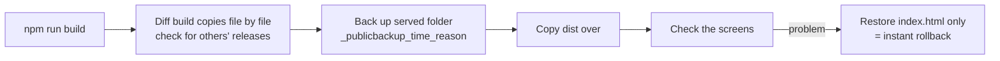

# 05. Operations — releases, rollback, versioning, change log, security

[← README](../README.md) · [한국어](ko/05-operations.md)

## Production cutover

| Item | Details |
|---|---|
| Cutover | On the morning of 2026-09-08 the new version took over the service port from the old one, with the production DB and attachments migrated as-is |
| Dry run | The migration script was run on a development PC first, comparing record counts, attachment files and logins |
| Rollback | The old version was kept intact, with a one-script rollback ready on the server console |
| Found along the way | The server OS time zone wasn't local time. Fixed it, and documented how to read earlier log and PDF timestamps |

## Releases

- Build output is content-hashed, so **old bundles stay in place**. Restoring one `index.html` is a rollback.
- The automated deploy script **refuses to run from inside the live folder**, which prevents accidental runs there.
- The server runs under `node --watch` and restarts on save. The flip side is that **saving a server file in the live folder is itself a release**, so server tests always run on a copy.
- Releases that change on-screen behavior wait for the business owner's approval.

## Versioning

| Part | Bumped when |
|---|---|
| Major | The operating model changes: going live, a full UI redesign, a data change that breaks compatibility |
| Minor | New or reworked screens and features; changes to business rules, permissions, notifications or approval flow |
| Patch | Bug fixes; wording, alignment, color or spacing tweaks; redeploys; rollbacks |

- One production release = one version. When a release mixes kinds, **the heavier one wins**.
- Every version was **back-filled from 0.0.1** using past release backups and the change ledger.
  0.x = before production, 1.0.0 = go-live (09-08), 2.0.0 = full design-system replacement (09-30).
- A tool bumps the version and appends a line to the history CSV; the "v<version> · <date>" in the UI footer is stamped at build time.

## Change ledger

Every source change is logged **before the task is closed**.

| Field | How to write it |
|---|---|
| Location | The **menu path users see**, not a file path: `Menu > Submenu > place on screen` |
| Change | One-line summary |
| Details | Previous problem + new behavior + operational notes, enough to make a decision from this line alone |
| Status | In source, not deployed / Live / On hold |

- The primary record is an append-only CSV; the spreadsheet people open is synced from it. If the spreadsheet is open while logging, the CSV still has the entry and catches up later.
- **Manual edits in the spreadsheet are preserved** (existing entries are never rewritten).
- **1,300+ entries** so far.

## Several AI sessions in one tree

I designed and built this with an AI coding agent (Claude Code), and several sessions often worked on the same working tree at once. So the rules were written into a document every session reads automatically:

- A new session reads **the current-state document → the latest HANDOFF document** before starting
- `git status` before every commit, to make sure nobody else's work is mixed in
- Diff build copies before every release (a rule born from an incident where one session's release overwrote another's)
- No ad-hoc edits or deletes in the live data folder; test servers run on copies only

Every incident became **cause → rule**, written back into that document.

## Security reviews

I review the system regularly and fix findings by priority.

| Example | Action |
|---|---|
| The account list was sent to the browser before login | Now sent only after a successful login |
| Nightly backups shipped offsite | Built AES-256-GCM encrypt/verify/decrypt tooling, limited which folders are exported, keep only the latest three automatically |
| A restricted folder on the external file server | Blocked across indexing, browsing, search and download |
| API keys and credentials | Never in source or the repository; only in server config files or environment variables, and responses reveal only whether one is set |

> Because this is a live internal system, review reports and specific paths or settings are not published.

## Next steps

- Unified authentication · HTTPS · company SSO
- Groupware (e-approval) integration, connecting separate department systems into one flow
- Preparing a cloud migration
