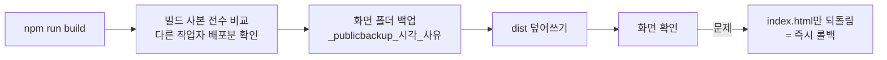

# 05. 운영 — 배포 · 롤백 · 버전 · 변경 이력 · 보안 점검

[← README](../../README.ko.md)

## 운영 전환

| 항목 | 내용 |
|---|---|
| 전환 | 2026-09-08 오전, 구버전에서 새 버전으로 서비스 포트를 인계. 운영 DB와 첨부 문서를 그대로 이관 |
| 사전 확인 | 개발 PC에서 이관 스크립트를 미리 돌려 데이터 건수 · 첨부 실체 · 로그인을 대조 |
| 롤백 | 구버전은 지우지 않고 보관. 서버 콘솔에서 스크립트 하나로 되돌릴 수 있게 준비 |
| 발견 | 전환 중 서버 OS 시간대가 한국 시각이 아니라는 것을 발견 → 교정, 그 전 로그 · PDF 날짜 해석 주의사항을 문서화 |

## 배포

- 빌드 결과물은 해시가 붙은 번들이라 **구 번들이 그대로 남습니다.** `index.html` 하나만 이전 것으로 돌리면 롤백입니다.
- 자동 배포 스크립트는 **운영 폴더 안에서 실행되면 스스로 거부**하게 했습니다. 운영 폴더에서 실수로 돌리는 사고를 막기 위해서입니다.
- 서버는 `node --watch`로 띄워 파일 저장만으로 재기동됩니다. 반대로 말하면 **운영 폴더의 서버 파일을 저장하는 것 자체가 배포**라서, 서버 시험은 반드시 복사본에서 합니다.
- 화면 동작이 바뀌는 배포는 현업 책임자 승인 후에 합니다.

## 버전 규칙

| 자리 | 언제 올리나 |
|---|---|
| 첫째 | 운영 체계가 바뀌는 변경 — 정식 운영 시작, 전 화면 재설계, 데이터 호환이 깨지는 변경 |
| 둘째 | 새 기능 · 화면 신설/개편, 업무 규칙 · 권한 · 알림 · 결재 흐름 변경 |
| 셋째 | 오류 수정, 문구 · 정렬 · 색 · 간격 손질, 재배포, 롤백 |

- 운영 배포 한 번 = 버전 하나. 기능과 수정이 섞이면 **무거운 쪽**을 따릅니다.
- 과거 배포 백업 폴더와 변경 이력 원장을 근거로 **0.0.1부터 소급**해 매겼습니다.
  0.x = 정식 운영 전, 1.0.0 = 운영 시작(09-08), 2.0.0 = 전 화면 디자인 체계 교체(09-30).
- 배포할 때 도구로 버전을 올리고 이력 CSV에 한 줄을 남기며, 화면 아래 「v버전 · 날짜」는 빌드 때 찍힙니다.

## 변경 이력 원장

소스를 고치면 **작업을 끝내기 전에** 반드시 기록합니다.

| 칸 | 쓰는 법 |
|---|---|
| 변경점 위치 | 파일 경로가 아니라 **앱 메뉴 경로** — `대메뉴 > 소메뉴 > 화면 내 위치` |
| 변경 내용 | 한 줄 요약 |
| 세부 내용 | 기존 문제 + 바뀐 동작 + 운영 시 주의 — 이 줄만 읽고도 판단이 서게 |
| 반영 상태 | 소스 반영 · 라이브 미배포 / 라이브 운영중 / 보류 |

- 1차 기록은 append-only CSV, 사용자가 여는 엑셀 원장은 거기서 동기화합니다. 엑셀을 열어 둔 채로 기록해도 CSV에는 안전하게 남고 나중에 따라잡습니다.
- 엑셀의 **수기 편집은 보존**합니다(같은 번호는 다시 쓰지 않음).
- 지금까지 **1,300건 이상** 기록했습니다.

## 여러 AI 세션이 같은 트리에서 일할 때

설계 · 구현을 AI 코딩 에이전트(Claude Code)와 함께 했고, 여러 세션이 동시에 같은 작업 트리를 다루는 일이 잦았습니다. 그래서 규칙을 문서로 만들어 매 세션이 자동으로 읽게 했습니다.

- 새 세션은 **현재 상태 문서 → 최신 인수인계(HANDOFF) 문서** 순서로 읽고 시작
- 커밋 전 `git status`로 남의 작업이 섞이지 않았는지 확인
- 배포 전 빌드 사본 전수 비교(다른 세션 배포분을 덮어쓴 사고 이후 생긴 규칙)
- 실데이터 폴더는 임의 수정 · 삭제 금지, 시험 서버는 복사본에서만

사고가 날 때마다 **원인 → 규칙**으로 바꿔 문서에 넣는 방식으로 운영했습니다.

## 보안 점검

운영 중에 정기적으로 직접 점검하고, 발견 사항에 우선순위를 매겨 조치합니다.

| 예 | 조치 |
|---|---|
| 로그인 전에 계정 목록이 화면으로 내려가던 문제 | 로그인 성공 이후에만 내려가게 변경 |
| 야간 백업을 외부 저장소로 반출 | AES-256-GCM 암호화 · 검증 · 복호 도구를 만들고, 반출 대상 폴더를 한정, 최신 3개만 자동 유지 |
| 외부 파일 서버의 보안 폴더 | 색인 · 열람 · 검색 · 다운로드 전 경로에서 차단 |
| API 키 · 자격증명 | 소스와 저장소에 넣지 않고 서버 설정 파일 · 환경변수로만. 응답에는 설정 여부만 |

> 운영 중인 내부 시스템이라 점검 보고서와 구체적인 경로 · 설정은 공개하지 않습니다.

## 남은 과제

- 인증 체계 일원화 · HTTPS 적용 · 사내 SSO 연동
- 그룹웨어(전자결재) 연동 — 따로 도는 부서 시스템을 하나의 흐름으로
- 클라우드 이관 준비
